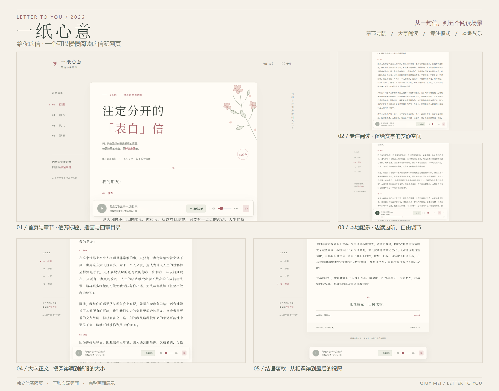

<!-- project-showcase:start -->

## 给你的信 · 一纸心意

把一封写给朋友的信，做成可以慢慢阅读的网页。

**信笺排版 · 四章导航 · 大字与专注阅读 · 本地配乐**

[看作品](#作品画面) · [下载网页源码](index.html) · [历次迭代](ITERATION_HISTORY.md) · [全部作品](https://github.com/qiuyimei/project-collection#作品图录)

## 作品画面

点击查看完整组合图；下方可分别打开各张原图。

<a href="docs/showcase/letter-desktop.png">首页与章节</a> · <a href="docs/showcase/letter-focus.png">专注阅读</a> · <a href="docs/showcase/letter-music.png">本地配乐</a> · <a href="docs/showcase/letter-large-type.png">大字正文</a> · <a href="docs/showcase/letter-signature.png">结语落款</a>

## 从这里开始

| 想做什么 | 入口 |
| --- | --- |
| 下载当前网页并在本机打开 | [index.html](index.html) |
| 查看每次迭代、日期与改动 | [历史版本目录](ITERATION_HISTORY.md) |
| 下载当前完整源码 | [当前版本 ZIP](https://github.com/qiuyimei/letter-to-you-2026/archive/refs/heads/main.zip) |
| 浏览当前工程 | [仓库文件](.) |

<!-- project-showcase:end -->

---

## 使用与项目说明

# 一纸心意 · 2026

一封写给朋友的信，做成安静、温柔的信笺页面。

## 使用

下载 `index.html`，用浏览器打开即可。不需要安装依赖或构建。

- 保留信件的十段原文，按相遇、珍惜、认可、祝愿分节。
- 适配电脑和手机，支持大字与专注阅读。
- 可选择本地音乐，支持播放、暂停、进度拖动、音量调整和单曲循环。
- 不包含机器朗读。
- 音乐文件只通过浏览器的临时对象地址播放，不会上传，也不会随仓库保存。刷新页面后需重新选择音乐。
- 字体、插画、样式和脚本都在 HTML 内，没有第三方页面资源。
- 阅读字号、专注模式、音量和循环偏好只保存在本机浏览器中；浏览器禁止存储时仍可使用。

## 修改

用文本编辑器打开 `index.html`。正文在 `.letter-paragraph` 段落中，颜色与字号在 CSS 的 `:root` 中定义，音乐逻辑在页面底部的 `<script>` 中。

音乐格式支持取决于浏览器；建议使用 MP3 或 WAV。页面不会自动播放，需要先选择文件，再点击播放。

## 验证

已核对正文逐字保留，并验证电脑与窄屏排版，以及浏览器中的本地音频选择、播放、暂停、循环和移除。

